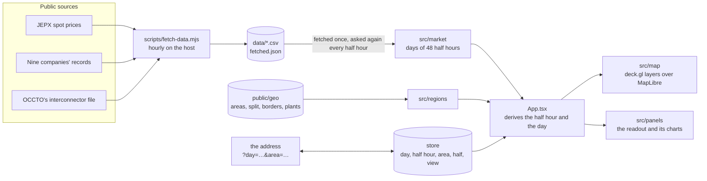
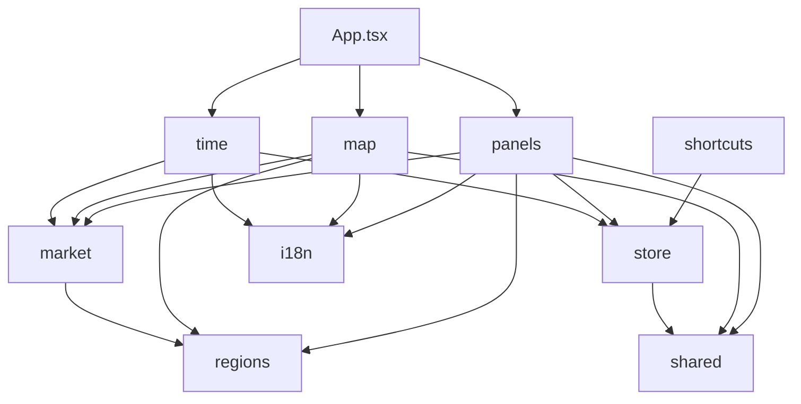
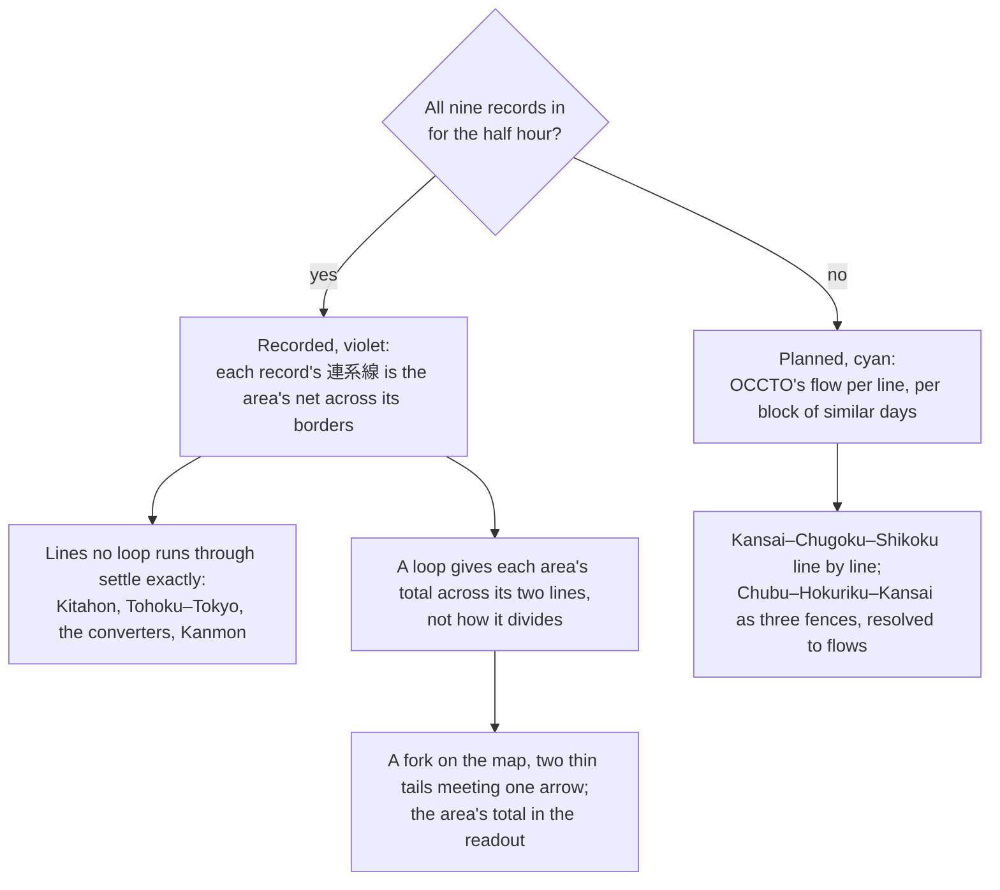
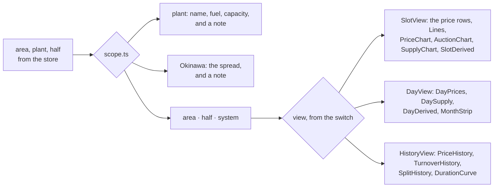

# Architecture

How fiftysixty works, as built; nothing here describes a model that was not built. [SCOPE.md](SCOPE.md) says what, in which order and what is still missing; [AGENTS.md](AGENTS.md) how to work on it.

## The shape of it

Public CSVs are fetched to static files by a script on the host. The browser parses them once into maps by day, the store holds what the reader has chosen, `App.tsx` derives the displayed half hour and day from the two, and the map layers and the panels read props, never the files. Nothing runs on the server but nginx and an hourly cron job.

### Where things are

| Directory | What it holds | Modules |
| --- | --- | --- |
| `src/market/` | The CSVs parsed into days of 48 half hours, and what is derived from them | `jepx` the prices; `record` with `jukyu`, `standard`, `kyushu` and `adapters` the nine companies' records; `flows` OCCTO's file; `interchange` the half hour's flows from either; `daily` the day's totals and price figures; `monthly` the month strip's days; `stack` the series; `history`, `splits` and `duration` the long view; `stories` the story days; `fetch` reads a file off the host, `fetched` the fetcher's note, `sources` the publishers' files and their freshness |
| `src/regions/` | The hand-written tables and the committed geometry | `areas`, `interconnectors`, `companies`, `names`; `geometry` and `plants` load the files |
| `src/map/` | The map view and the deck layers as pure functions of the data and a palette | `MapView`, `layers`, `flowLayers`, `plantLayers`, `outline`, the `MixGlyph` columns, `scale`, `basemap`, `layerChoice` |
| `src/panels/` | The readout and its charts | `readout/` the panel in parts: `scope`, `Readout`, `Headline`, `Switches`, `SourceHeading`, `SlotView` with `Lines`, `DayView`, `Derived`, `HistoryView`; `provenance` the tooltips' files and fields; the `DayChart` frame with `SupplyChart`, `PriceChart` and `AuctionChart`; `MonthStrip`; `PriceHistory`, `TurnoverHistory` and `SplitHistory` with `heatmap` and `MonthTicks`; `DurationCurve`; the corner's `Legend`, `Layers`, `Corner` and `Credits` |
| `src/time/` | The clock | `days`, `slots`, `TimeBar`, `usePlayer`, `useNow` |
| `src/shared/` | What the rest share | `scale` and `palette` for the colors, `theme`, `format`, `storage`, `scrub`, `link`, `ErrorBoundary`, the media-query hooks, `useElementSize` |
| `src/i18n/` | Every visible word in both languages | `strings`, `useStrings` |
| `src/` | The root | `store.ts` the reader's choices, `shortcuts.ts` the keys, `App.tsx` the root that loads and derives |
| `scripts/` | What runs outside the browser | `fetch-data` hourly on the host, `build-regions` and `build-plants` for the committed geometry, `screenshot` for the captures |

The directories depend on each other one way, so the parsing never knows the map and the map never reads a file.

## The data

### The fetcher

`scripts/fetch-data.mjs` fetches three kinds of file: JEPX's spot-market CSV for the current fiscal year and the previous one, the nine transmission companies' supply-demand records for the current and the previous month, each from its own host under OCCTO's file name, and OCCTO's interconnector file for the previous, the current and the next month, a month per request and once a day.

They land in `public/data/` in development and the web root's `data/` in deployment, where a cron job installed by `deploy.sh` refreshes them hourly, since the companies add each half hour to the running month within about an hour. A file already held is asked for with If-Modified-Since and left alone when the host says it has not changed.

All are CSV with Japanese headers. JEPX is UTF-8 and the records Shift_JIS, or UTF-8 some months at TEPCO, so the fetcher decodes each as UTF-8 when valid and Shift_JIS otherwise, and writes UTF-8. JEPX serves its file only with its market page as the referer; last fiscal year's file is taken once, since it is final from March, so the winter is there for the story days.

Tohoku posts the running month as one file per day and the month's own file only around the 25th of the next, so its month is stitched from the days. A month no company has published at all is skipped, as Chubu's previous month is, which sits behind a download form.

Each run ends by writing `fetched.json` beside the data, the run's time and each file's, which the about modal reads. A host down for the hour fails that source alone, logged by name, the run going on and exiting non-zero at the end.

### The prices

`market/jepx.ts` parses JEPX's spot CSV into a map from delivery day to its 48 slots, each with the system price, the nine area prices keyed by area id, and system-wide the sell bids, the buy bids and the contracted volume. The columns are found by their Japanese names, so a reordered header still parses and a missing one is an error.

`App.tsx` loads the current and the previous fiscal year's files once, merged by day, and passes the displayed slot's prices down as props.

### The records

`market/record.ts` is the interface one transmission company at a time is wired behind: an adapter names the file for a month and parses it into days of half-hour slots with the demand, the MW by source, pumping, charging and exports negative, and the solar and wind curtailment. The newest day runs only to the latest published half hour.

The companies share one layout with small departures, so `market/jukyu.ts` parses it once with two knobs, whether the time names the start or the end of the half hour and the sign of the interconnector column, after normalizing quoted cells, both date forms and full-width header characters. `market/standard.ts` makes the adapter for a company publishing the layout as is, which all but Kyushu do; `market/kyushu.ts` departs from it, with end-marked times and flow counted positive when it leaves the area, so its sign is inverted to keep imports positive. `market/adapters.ts` is the table by area, all nine wired.

`App.tsx` loads the month of the displayed day on demand for every wired area, not only the picked one, and remembers it, a month missing on the host being no record rather than an error. It asks for it again every half hour, as it does the prices and the fetcher's note, so a tab left open follows the host's hourly fetch and learns of the next delivery day, and again after a failure.

### OCCTO's plan

OCCTO's reserve-margin site publishes, for every interconnector and half hour two days ahead, the operating capacity in each direction, a planned flow and whether the day-ahead market split across the line. `market/flows.ts` parses the month's CSV into days of lines, the time naming the end of the half hour.

OCCTO gives Kansai–Chugoku as two rows, east and west, which are one line monitored at two sections, not two circuits: the same power crosses both, so the flow is taken once, the tighter section's capacity binds, and a split at either counts.

Its flow is a plan, not a forecast of the day: whole days repeat across a block of similar days and are not revised afterwards. Against the nine records over August and September 2026, each area's planned net import centers within about 200 MW of its recorded 連系線 but misses a given half hour by up to two gigawatts.

`regions/interconnectors.ts` names OCCTO's lines with their forward direction, settled from the flow signs against the price differences over a month: north to south and east to west, so out of Chubu and into Hokuriku and Kansai across the three fences OCCTO publishes around that triangle instead of single lines. Measured per-line flows exist only on OCCTONET behind a browser session and are not fetched; what actually crossed comes from the records.

### Recorded or planned

`market/interchange.ts` makes each half hour's flows one kind or the other, never a mix, and nothing is guessed.

When all nine companies' records are in, each record's 連系線 is that area's net across its borders, which settles Kitahon, Tohoku–Tokyo, the frequency converters and Kanmon exactly, since no loop runs through them, and for each loop, Chubu–Hokuriku–Kansai and Kansai–Chugoku–Shikoku, every area's total across its two lines of it, but not how that divides between the lines. Checked over September 2026, the recorded totals meet each record within 81 MW, the transmission losses.

Otherwise they are OCCTO's plan, which sets a flow per block of similar days, weekdays or a weekend and its holidays, and is never revised to what happened; it gives the Kansai–Chugoku–Shikoku loop line by line and the Chubu–Hokuriku–Kansai loop only as its three fences.

Both kinds brighten toward the line's operating capacity, and in the readout the lines stand under the header of the kind the half hour shows, OCCTO's plan or the records.

### A day in energy

`market/daily.ts` totals a day from its half hours, each half hour's average MW making half as many MWh: the energy each source supplied, what came from storage and across the borders, curtailment, and the peak and the low of demand.

All Japan, or a half of the grid, is the sum of the areas that have recorded the day, one set of areas for the whole day, so no line jumps where an area's half hours stop, and cut short to the half hours every one of them has. The areas left out are named beside it, "without Hokkaido, not recorded yet", since a company's lag would otherwise pass for a quiet day. The border flows cancel out and are left out, and the peak is taken from the areas' half hours summed; the shares and the CO₂ per kWh hold without an area, the totals undercount by it.

The day's price is weighted by demand, each area's price by its own use for Japan, so the evening counts for more than the night. `priceStats` gives a day's price in figures for an area or for the system price, the mean over its half hours and the lowest and the highest with when; `spreadStats` the lowest and the highest across a half's areas with where and when, since a half has no price of its own.

The CO₂ is an estimate, labeled so: the fuel each area burnt, coal, LNG, oil and the other thermal column, each by its factor after CRIEPI's 2016 assessment of Japan's generation, biomass as none; with the grams per kWh the area generated. The about modal gives the factors.

`market/monthly.ts` gives the month strip its days: an area's whole days, a scope's whole days summed from any day one of its areas recorded, the month's priced days, and a half's spread with its weighted tick.

### The story days

`market/stories.ts` finds them in the prices held, so they move as the data grows: the summer and the winter peak by the system price, the widest split between areas, the day with the most area half hours at the exchange's floor, and the cheapest day by the mean system price. The time bar offers them in a menu that jumps to the day and the half hour.

## The regions

### The areas

`regions/areas.ts` is the hand-written table: ten areas with their names, frequency and prefectures by JIS code, the boundaries following the prefecture lines. The nine with a price are typed apart from Okinawa, which has neither a price nor an interconnector.

`scripts/build-regions.mjs` fetches the prefecture polygons from dataofjapan/land and dissolves them per area with mapshaper, which is not a dependency but fetched by npx for this script alone, since its native addons have no place on the host. It drops islands under 20 km², simplifies to 5% and writes `public/geo/areas.geojson`, 56 kB and committed, credited to 地球地図日本 in the credits.

The 50/60 split line is the inner boundary between the dissolved halves, written beside it. `borders.geojson` is the border along each interconnector: the edges the two areas' polygons share, chained into lines, or across water the line equidistant from the two coasts, traced on a grid over the water between them and clipped where the sea opens out or a third area is nearer.

`regions/interconnectors.ts` is the hand-written list of the ten lines with their ends and kind, AC, HVDC or the frequency converters; the capacities come with OCCTO's file.

### The plants

`scripts/build-plants.mjs` asks Overpass for Japan's power plants tagged with an electric output in OpenStreetMap, keeps the 419 of 10 MW and up with their fuel folded onto the chart's series and their capacity as mapped, and commits them as `public/geo/plants.geojson`, 73 kB, credited to OpenStreetMap in the readout whenever a plant is shown. It can read a saved Overpass answer instead of asking again.

## The map

### The page

A header with the name and a map that fills the rest, the same skeleton as nebulosa. `App.tsx` lazy-loads the map view so MapLibre is a chunk of its own, cached across deploys. The map is MapLibre over OpenFreeMap's `fiord` style, bounded to Japan, with the navigation control, its own attribution off in favor of `panels/Credits.tsx`, a modal behind the header's ⓘ saying what the page is, naming every source and saying when the host last fetched, the page held still beneath it.

A deck.gl `MapLibreOverlay` is interleaved into the map beneath the style's first label layer, so the market layers sit under the place names. `map/layers.ts` builds the deck layers as a pure function of the loaded data and a numeric palette, `shared/palette.ts`, which mirrors the CSS tokens for WebGL.

MapLibre 6 loads its web worker from a file next to its own script, which a bundled app does not have, so the worker is bundled explicitly and registered at startup, and the browser test waits for a tile request, which only the worker makes.

`shared/ErrorBoundary.tsx` around the page's body stands a note in for whatever threw, so a fault reads as a sentence and not as a blank.

### The theme

`index.css` carries the dark and light token sets, with two colors named for the halves of the grid, `--hz50` and `--hz60`, so the split can be drawn in the app's own palette; `shared/palette.ts` holds their numeric twins for WebGL, one `Palette` per theme.

`shared/theme.ts` resolves the reader's choice, system, light or dark, kept in the store and in local storage, against the operating system's preference; `App.tsx` stamps it on the document as `data-theme` and a button in the header flips it. The basemap follows, fiord in the dark and positron in the light, and the layers are interleaved beneath each style's own first label layer.

### The price on the map

With prices, the areas are filled through `shared/scale.ts`: a ramp per half of the grid, blue for 50 Hz and amber for 60 Hz as in the name, each from near the surface to bright over a fixed 0 to 50 yen domain, so one day's colors mean the same as another's and the two halves stay told apart. Okinawa, which has no price, is muted.

Where two areas an interconnector joins cleared at different prices, which is what a market split is, a wall stands on their border, so the areas walled in together are the markets the auction settled that half hour. The walls come from the prices alone, so they stand for the whole price history and not only the months with flow data.

### The key and the layers

`panels/Legend.tsx` is the key: the two ramps with the ends they share, drawn arrows for a planned flow, a recorded one and one at the limit, a fork, and the wall.

`panels/Layers.tsx` is the Layers panel: a box each for the flows' arrows, the mix columns and the plants, kept for the next visit by `map/layerChoice.ts`. The plants' box shows or hides them all and is half-checked while some fuels are hidden, which is the whole of the plants' state, every fuel hidden being the plants off, as by default; a chevron beside it opens their filter, by the same token the fuels' key: a row a fuel with its swatch and its count of plants, pressed when shown.

`panels/Corner.tsx` holds both behind a Layers and a Key icon button in the corner, one open at a time, the key open by default on a wide screen and both folded on a phone. Each carries a close button of its own.

### The columns

For every wired area, `map/MixGlyph.tsx` centers a column on the area's anchor point, a hand-picked spot in the middle of its land in `regions/areas.ts`: the chart's bands in the same colors, imports gray on top, curtailment as a hatched cap, what left the area as a gray stub below the line, and the demand as its height and its label. It is a MapLibre marker whose content React renders through a portal, so it shares the theme tokens, and clicking it picks the area.

An area without a record for the slot, the future or a company's lag, gets an empty dashed column marked no data in its place, so the gap reads as the data's and not as a fault.

The columns, the arrows and the plants scale with the map's zoom through `map/scale.ts`: full size at zoom 5, a desktop window showing all of Japan, halving with each level out so a phone's map at about zoom 4 is not swamped, and growing in only by half, so zooming close does not blow them up. Below six tenths the figure under a column is left off.

### The arrows

`map/flowLayers.ts` lays each line from where the power comes to where it goes, so a reversed flow flips the arrow: a shaft that starts clear of the column it leaves and tapers from a hair to a pixel plus one per gigawatt where the head begins, colored from idle to full by how much of the operating capacity the flow takes.

The shaft is one `SolidPolygonLayer` shape whose widths are turned from pixels into degrees at the map's zoom and rebuilt as it zooms, so it keeps its size on screen and never has a joint. It stops where an `IconLayer` triangle in the same color, anchored at its base, sized with the shaft and turned to the line's heading on the mercator plane, points on.

Both ends keep clear of the columns by pixels, the box a column draws over its anchor measured along the line's heading, so a phone's smaller map does not tuck the heads under the columns; a line too short for that keeps two fifths of itself as the shaft.

### The plants on the map

`map/plantLayers.ts` draws the plants as dots in the series colors, their area following the capacity at full size, scaled with the map like the columns but growing no further in, the picked one outlined, the fuels hidden from the key left out. They show once switched on in the Layers panel, since at any zoom but close in they crowd the columns.

A picked plant takes the readout with its name, fuel and capacity and the note that what it runs is not public; picking a plant lets the area go and the other way round.

### The halves on the map

With a half chosen, the other half is muted like Okinawa, its walls left out and its arrows and columns faded, while the half is outlined in its hue. `map/outline.ts` takes the edges of its areas' polygons that no second area of the half shares, which is its coast and the split line, since the areas were dissolved and simplified together and meet edge for edge. The map follows the readout, so a picked area lifts the dimming and Escape brings it back.

## The readout

### The panel

`panels/readout/` is the panel beside the map, in parts. `scope.ts` says what it is about, computed once from the reader's choices: a picked plant, Okinawa, a picked area, a half of the grid or the system. The headline, the switches and the three views each branch on the scope, so a view never shows a scope that has nothing for it.

With nothing picked, the headline is the system price and the half hour's note the spread across the areas. An area picked by a click on the map shows its price against the system price and against each neighbor across an interconnector, then its lines and what ran in it. The picked area is outlined on the map, and a back button on the left of its name goes up a level, since a tap on the map elsewhere does the same.

The rows stand in groups under who published them, since a day-ahead price JEPX contracted the day before, an actual a transmission company recorded within the hour after delivery and a flow OCCTO planned two days ahead are three kinds of number. `readout/SourceHeading.tsx` is the header, in small caps on one line: JEPX day-ahead, the picked area's company by its short name from `regions/companies.ts` or the companies' records for a half or all Japan, OCCTO plan, and derived for what this site computes, each with what kind of number it is as a muted tail, contract prices, actuals, a plan never revised, computed here; when each publisher speaks is the about modal's table, since a tail about timing read oddly on a day long settled. The lines go under OCCTO's header when the half hour has the plan alone and under the record's when the records settle them, and the derived figures, the price weighted by demand, the turnover, the renewable share and the CO₂, stand together at the end rather than among the published ones. Every label carries a tooltip from `panels/provenance.ts`: the file and the field the figure is read from, the company's name for a record, or the formula for a derived one, and when the host last changed the file, from `fetched.json` through a context the panel provides, so a tooltip in a chart's key needs no props threaded to it.

The headline row stays pinned at the top of the panel while the rest scrolls under it, and the switches with it where the screen is tall enough, `shared/useShort.ts` reading a media query, so the scope and the view are a tap away wherever the reader is, while on a short phone the content keeps the room. A data file that could not be loaded is said under the headline, pinned, until the next try succeeds, since a host down would otherwise pass for a quiet day.

On a phone, `shared/useNarrow.ts` reading one media query kept in step with the CSS modules, the panel is an accordion: its headline row, the name and the price with a chevron, is the button that opens the rest, and another pick opens folded again. It leaves the right edge to the map's navigation control, whose compass points north again.

The charts are sliders under a finger too. `shared/scrub.ts` is their pointer handling, and their styles leave the vertical pan to the browser, so the panel scrolls over them, a sideways drag scrubbing and a tap picking once the finger lifts, so a scroll that starts on a chart does not move the half hour.

`App.tsx` measures the time bar with `shared/useElementSize.ts` and sets its height as a variable on the main element, so wherever the bar spans the foot, under 1024 pixels of width, where it wraps rather than clip, the corner sits above it however many rows it wraps to.

### The half hour

`market/stack.ts` groups the record's fourteen columns into eight series in a fixed stack order, coal and nuclear at the bottom, gas and hydro on top, with pumped storage and batteries apart from the interconnectors, each signed: above the stack storage generating in a light gray and then imports in a darker one, below zero storage charging and then exports, so the interconnector rows answer to the lines; curtailment is a hatched band on top. The order was chosen so every adjacent pair stays apart under color-blindness, checked with a validator rather than by eye; the series colors are CSS tokens, `--src-*`, in both theme sets.

`panels/DayChart.tsx` is the frame the day charts share, with its geometry in `panels/slotAxis.ts`: an SVG 320 units wide with the axis labels in a gutter on the left and the 48 half hours across the rest, the displayed one marked over whatever is drawn and the hours along the foot. It is itself a slider: pointing or dragging moves the half hour, and with it focused the page's keys still do, so the readout beside it is the tooltip.

`panels/PriceChart.tsx` draws the displayed day's auction first, so the charts scrub together and the marker runs through all of them. The system price is a thin dashed line in the text color, and over it the picked area's price in its half's price color, `--price50` or `--price60`, a stop of the map's ramp that reads against the panel; or with nothing picked every area's thinner and solid, the areas on one price drawing as one line, so the day reads as two or three lines that fork where the market split. The axis, `priceAxis` in `shared/scale.ts`, is zero-based with the top at the gridline above the day's highest drawn price and never under 20 yen, so a cheap day reads as flat and low rather than noisy and a floor half hour sits on the zero line. A key under it names the lines.

With nothing picked, `panels/AuctionChart.tsx` draws under the price curve what lies behind the system price: the sell bids, the buy bids and the contracted volume JEPX's file carries per half hour, as three lines over a zero-based gigawatt axis, the energy of a half hour as the power it averages, with the gap between the two bids shaded, since when far more is offered than asked the price falls to the floor. The lines are told apart by weight and dash alone, offered dashed, asked thin and cleared heavy, so the chart takes no color from the sources or the halves; the key carries the half hour's figures and its turnover.

`turnover` in `market/jepx.ts` is the cleared energy at the system price, in yen. JEPX gives the volume system-wide alone, so it is exact while every area clears at the system price and close when they split, and it is shown for the system only: the half hour's in the auction chart's key, the day's in the day view, and every day's in the long view. The demand at each area's price would be a larger figure and not a market's, since much of it never goes through the exchange.

`panels/SupplyChart.tsx` draws the day as the stack under the demand line, the gigawatt labels in the gutter and a solid line at zero, drawn over the bands so the part below it reads as what left the area; the gridlines step with the range, about five whatever the scale. Under it, the chart's key and the half hour's figures are one table, a row a series read top down as the chart stacks, the idle rows muted, each supplying row with its share of what supplied the half hour; the half hour's renewable share and its CO₂ per kWh generated follow under the derived header.

With nothing picked the supply is all Japan's, or the chosen half's, the areas not yet recorded named beside it; the interconnectors cancel between the areas and are left at none, so the key drops its import and export rows. The hour labels are drawn once, on the last chart of the stack.

### The day

A switch at the top of the readout turns it from the half hour to the whole day. `panels/readout/DayView.tsx` lists the day's prices first, as the price curve stands above the supply chart: the mean and the lowest and the highest with when, for any priced day, one without a record included, since the auction runs a day ahead of the record, and the half hours at the floor; the demand-weighted price where the record allows it and, for the system, the day's turnover stand with the derived figures after the supply.

Under them the supply as one bar and a table of each source's GWh and share, read from the top as the chart stacks, then the day's figures; a day still under way says how far it runs.

Under it, `panels/MonthStrip.tsx` sets the displayed month's days side by side under the month's name. A price row above a supply row: a bar for every priced day from its lowest half hour to its highest over a zero-based scale from `priceAxis`, in the picked area's price color or the panel's strong border tone for the system price, with the mean as a tick; and a bar a day as tall as the day's supply against the month's most, banded by the sources. Every day of the month has its column, the ones with neither a record nor a price left blank, so a column keeps its width as the month fills.

One slider spans both rows: pressing and dragging across it moves the map through the days, a press on a blank snapping to the nearest day with data, a day's demand and mean price read out together. For all Japan, a day with an area missing is drawn faint and says which.

### The long view

The third view, after the half hour and the day, lays the whole price history held, two fiscal years at most, in four figures on the same days.

`market/history.ts` lays out every priced day as its 48 prices by half hour, the picked area's or the system's; `panels/PriceHistory.tsx` draws them as a heatmap, a day a column across and the half hours down from midnight, each cell in the map's own ramp over its fixed 0 to 50 yen domain, so a cell means what the map's fill means: the area's half's ramp, or for the system price, which is of neither half, a neutral one. `panels/heatmap.ts` computes the pixels, a device pixel a column so a year fits the panel, each column the mean of the one or two days that fall in it, and the component puts them on a canvas, since two years of cells are too many SVG nodes. It is a slider over the days with the pointer working in two dimensions, pressing or dragging on a cell setting the day and the half hour, which a crosshair marks.

Each day of the history carries its turnover too, and where the system price is the one drawn, with nothing picked or a half, `panels/TurnoverHistory.tsx` stands it under the heatmap in the same frame at half the height, so the days line up: a column a day as one SVG path, from zero to a round figure above the most turned over, in the language's large unit, the displayed day marked and its figure in the key. It is a slider over the days as well.

`market/splits.ts` gives every priced day's share of half hours in which each line's two ends priced apart, which is what a wall marks, over the scope's lines: a picked area's own borders, the frequency converters alone for a half, all ten with nothing chosen. `panels/SplitHistory.tsx` draws them as a second heatmap, a line a row named by its ends and a day a column, each cell from the surface to the split line's own color, the displayed day marked, so the Tokyo–Chubu row is the halves parting through the year; it is a slider over the days like the heatmap above it.

`market/duration.ts` sorts every priced half hour held from the dearest down and reads off it the mean, the median, the price a tenth of the time stood above and the share at the floor; `panels/DurationCurve.tsx` draws the curve across the width in the day charts' frame, zero-based on the same axis rule, the picked area's price in its half's color or the system price, the displayed half hour marked where it ranks. It is a slider over the ranks: a press picks the half hour whose price ranks there, so a drag walks the history from the dearest half hour to the cheapest with the heatmap's crosshair following.

The month ticks along the foot of the heatmaps are one component, `panels/MonthTicks.tsx`, a tick where a month begins with its name where there is room and the year in place of January; `heatmapPixels` takes any column of values over any domain.

### The halves

A half of the grid is a scope between all Japan and an area, since the 50/60 split is what the site is named for. It is not a level like an area, so it is chosen from a three-way control above the view switch rather than a pick on the map, all Japan, 50 Hz and 60 Hz, the halves in the hues of the name so the scope reads apart from the views. The choice is kept in the store across the views and the picks, hidden while an area is picked since an area is in one half already, and let go by the control's All Japan or by Escape after a picked area.

With a half chosen the headline is the half's spread across its areas, or their price when they agree, the system price noted under it; the price curve draws the half's areas alone over the system price, the other half's key dimmed; and what ran is the half's areas summed, in the half hour, the day and the month strip, the areas not yet recorded named under the half's name.

Its prices are kept to what JEPX publishes, since a half has no price of its own: in the half hour the system price and each of its areas against it, and its lines the frequency converters alone, as its imports or exports against their limit, since nothing else crosses the middle; in the day the price weighted by demand where the records allow it, the lowest and the highest across its areas with where and when, and the area half hours at the floor; in the month strip the spread as the day's bar in the half's color, the tick its weighted price where the day's records are whole and none otherwise; and in the long view the system price, under a note that says so.

## The clock

`store.ts` holds what the reader has chosen, the delivery day, the half hour, the area or the plant, the half and the view, as plain zustand actions tested without React. A day not chosen is the opening day from `time/days.ts`: yesterday in Japan, the newest day whose record is complete after the daily fetch, when it is priced, else the newest priced day.

`time/TimeBar.tsx` is a controlled row of native inputs, which scrub and take the keyboard for free. A step to the priced day before and after stands around the day with its weekday, ISO in English and in words in Japanese, over a native date picker bounded to the priced days, since the native input's own words follow the browser's language rather than the page's. A menu jumps to the half hour under way or to a story day.

Play runs at four half hours a second through `time/usePlayer.ts`, on into the next priced day and stopping at the end of the data. A day or a half hour chosen by hand, from the bar, the chart, a story or a key, pauses it.

A range spans the 48 slots, with the half hour read out beside it under a word for where it stands, yesterday, today or tomorrow, and on today whether it is now or still ahead of the clock in Japan, which `time/useNow.ts` ticks once a minute, since the day-ahead price is known before the record.

### The address

`shared/link.ts` names the reader's position in the data and what the readout is about as a query string, `?day=2026-09-23&slot=24&area=kansai&view=day`, only what differs from the opening view, so the opening page keeps a plain address. The store writes it with `replaceState` as the choices change and reads it once at load, so a half hour worth showing is a link to paste.

A plant stands for its area in it, a half is left out while something is picked, a day the prices do not hold falls back to the opening day, and the opening day chosen is no choice, so stepping back to it leaves the address plain. The theme, the language and the layers, kept for a visit, stay out of it.

The name in the header is a link to the plain address, the opening view, and takes the page back to it in place, since Now is today's half hour and the opening day is yesterday's.

## The chrome

### The keys

`shortcuts.ts` is the keyboard scheme in one table, as in nebulosa, and the about modal lists the keys from the same table:

- The arrows step the half hour and, with Shift, the day; up and down walk the areas north to south.
- Space plays, N is now, T the theme, Escape lets a plant, an area or a half go, and ? opens the about.

The map's own keyboard handling is off, so an arrow pressed after a tap on the map moves the clock and not the view. The handler acts on the store and leaves a focused field or button its own keys, but not the charts: they are sliders for the pointer, and an arrow on them still steps the half hour and Shift with it the day. A pointer click on a button drops its focus so the keys keep working, a keyboard activation keeps it.

### Two languages

`i18n/strings.ts` holds every visible word by key in English and Japanese, the layout never changing with the language, only the words; a test checks both tables carry the same keys. The choice, stored like the theme and defaulting to the browser's language, is read through `useStrings` in each component.

The area and line names come from the tables in `regions/`, which carry both languages already, and the readout's figures, units and JST times stay as they are. `App.tsx` stamps the language on the document and a select in the header lists the languages by their own names, and the map view sets every label layer's text to the language's name with the latin name as the fallback, since OpenFreeMap's tiles carry names in both.

### Accessibility

`e2e/a11y.spec.ts` runs axe over the page in its main states, the opening view, an area picked, the layers open, the about, and the light theme, and fails on any serious or critical finding, the map's canvas aside. The chart's key doubles as its table of figures.

The about modal takes focus, keeps Tab inside and gives focus back to the button that opened it. Every label is in the language, the map's region included; motion stops under the reduced-motion preference; and on a touch screen the time bar's controls are finger-sized.

## Tests

Unit tests run on real rows cut from the JEPX file, all nine companies' records and OCCTO's file, and the derived modules are tested on the same fixtures. Component tests render the panels with the map mocked.

Playwright runs against the built app in headless Chromium, on a desktop and a phone viewport, the clock pinned to a morning the fixtures cover, with the basemap's tile requests answered empty and the data files served from the fixtures, the JEPX, TEPCO, Kyushu and OCCTO ones, the other companies' answered with 404 so the states with areas unrecorded are exercised too. Nothing depends on a third party but the style. Axe runs over the main states.
